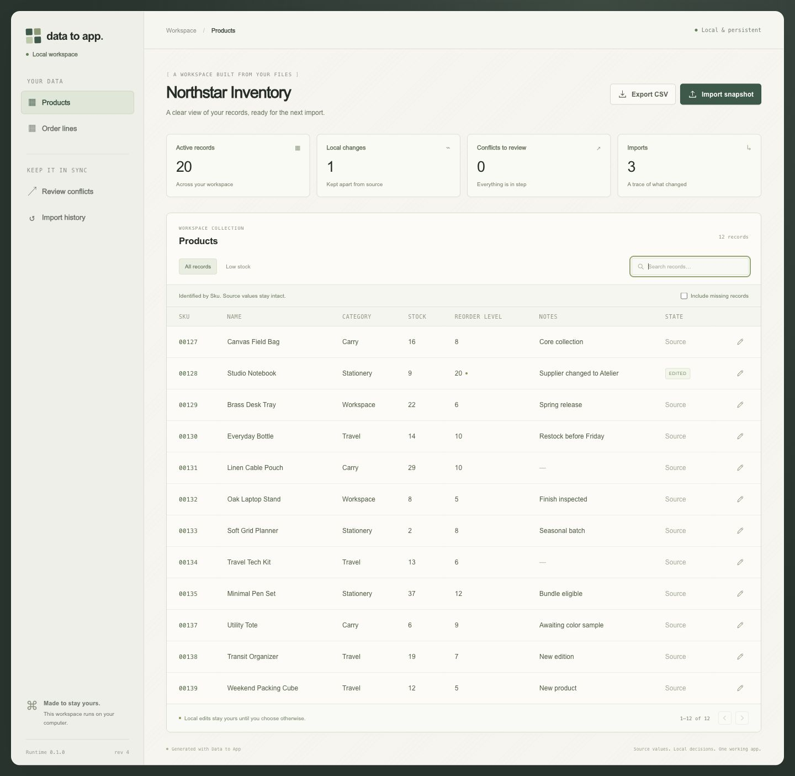

# Data to App

### ให้ไฟล์กลายเป็นซอฟต์แวร์ และให้การตัดสินใจของคุณอยู่ต่อในการนำเข้าครั้งหน้า

[English](README.md) · [Tiếng Việt](README.vi.md) · [한국어](README.ko.md) · [日本語](README.ja.md) · [Español](README.es.md) · [Português](README.pt-BR.md) · [简体中文](README.zh-CN.md) · [ไทย](README.th.md) · [Français](README.fr.md)

**ส่งไฟล์และงานจริงให้ Claude หรือ Codex แล้วรับแอปที่คุณรัน ตรวจสอบ และเป็นเจ้าของได้**

Data to App เปลี่ยน CSV และ Excel เป็นซอฟต์แวร์สำหรับงานที่ติดตามแหล่งข้อมูลได้ มีการค้นหาระเบียน มุมมองที่เป็นประโยชน์ การแก้ไขที่อนุญาต และการนำเข้าซ้ำ Agent วางขั้นตอนงาน ส่วนเครื่องยนต์ Python/SQLite ที่มีพฤติกรรมกำหนดชัดเจนแยกข้อมูลต้นทาง การแก้ไขในเครื่อง และสแนปช็อตใหม่ คุณได้รับแอปที่ทำงานได้ ซอร์สโค้ด และข้อมูลในเครื่อง

**[สร้างเวิร์กสเปซแรกของคุณ](#เรียกใช้เวิร์กสเปซสินค้าคงคลัง)** · **[ติดตั้งสำหรับ Claude หรือ Codex](docs/INSTALL.md)** · **[สำรวจข้อตกลงข้อมูล](docs/DATA-CONTRACT.md)** · **[สำรวจเดโมพร้อมคำแนะนำ](https://hieunguyenak92.github.io/data-to-app/)**



*ภาพจากระบบที่รันในเครื่องจริงโดยใช้ข้อมูลจำลอง หลังนำเข้าสแนปช็อตใหม่และคงการแก้ไขในเครื่องไว้*

> **การนำเข้าครั้งต่อไปที่ชัดเจน** ค่าต้นทางคือ `12` คุณแก้เป็น `20` แต่ไฟล์ใหม่ระบุ `14` Data to App เก็บ `20` ของคุณไว้และแสดงข้อขัดแย้งระหว่างต้นทาง ค่าในเครื่อง และค่าใหม่ให้ตัดสินใจ การเปลี่ยนแปลงที่ตรงกันจะรวมเข้าหากัน ส่วนการตัดสินใจที่ต่างกันยังคงมองเห็นได้

## เริ่มจากงานจริง

หลังจาก [ติดตั้ง skill](docs/INSTALL.md) ให้สั่ง agent ด้วยภาษาธรรมดา:

> ใช้ Data to App กับ `./exports` สร้างเครื่องมือสินค้าคงคลังในเครื่องที่ค้นหาสินค้าได้ มีมุมมองสินค้าต่ำกว่าเกณฑ์ และแก้ไขเกณฑ์สั่งซื้อกับหมายเหตุได้ เก็บการแก้ไขเหล่านี้ไว้เมื่อนำเข้าไฟล์ชุดถัดไป และแสดงสิ่งที่ต้องตัดสินใจ เปิดแอปและตรวจสอบการทำงานหลักด้วย

Skill จะนำ agent ผ่านการตรวจไฟล์ การเลือกตัวตนของระเบียนและการทำงาน การสร้างแอป และการทดลองใช้งาน คุณอธิบายงาน ส่วน agent จัดการโมเดลทางเทคนิค หากคีย์ หน่วย หรือกฎธุรกิจมีความกำกวมที่สำคัญ อาจต้องมีคำตอบที่ชัดเจนจากคุณ

เหมาะกับไฟล์ส่งออกสินค้าคงคลังและคำสั่งซื้อ รายชื่อผู้ติดต่อที่ต้องแก้ไขต่อเนื่อง หรือระเบียนโครงการและบริการที่ได้รับเป็นไฟล์ตามรอบ รุ่นแรกเน้นตารางในเครื่องที่มีคีย์ของตนเองและขั้นตอนงานที่ร้องขอ

## ออกแบบเพื่อการนำเข้าครั้งที่สอง

| ความสามารถ | สิ่งที่ได้รับ |
| --- | --- |
| **วิเคราะห์โดยคำนึงถึงตัวตนระเบียน** | หลักฐานเรื่องคีย์ที่เป็นไปได้ ค่าว่าง ข้อมูลซ้ำ และรหัสที่มีเลขศูนย์นำหน้า |
| **ตรวจการเชื่อมตารางล่วงหน้า** | ตรวจคีย์ที่ไม่ตรงกันและความเสี่ยงที่จำนวนแถวจะเพิ่มทวีคูณก่อนรวมข้อมูล |
| **กระทบยอดสามทาง** | แยกค่าต้นทาง ค่าในเครื่อง และค่าที่เข้ามา พร้อมตัดสินใจรายฟิลด์เมื่อขัดแย้ง |
| **ดูตัวอย่างก่อนนำเข้า** | ตรวจรายการใหม่ รายการอัปเดต ระเบียนที่หายไป และข้อขัดแย้งก่อนใช้สแนปช็อต |
| **หน้าจอสำหรับทำงาน** | ค้นหา มุมมองที่ตั้งค่าไว้ การแก้ไขที่อนุญาต การแก้ข้อขัดแย้ง ประวัติ และส่งออก CSV |
| **ซอร์สแอปที่ย้ายไปใช้ได้** | แอป Python/SQLite พร้อมทรัพยากรในเครื่อง รันได้โดยไม่พึ่ง skill ที่ติดตั้งไว้ |

เครื่องมือเหล่านี้ให้หลักฐานประกอบการตัดสินใจ คอลัมน์ที่ไม่ซ้ำในไฟล์เป็นเพียงคีย์ที่เป็นไปได้ ยังไม่ยืนยันว่าเป็นตัวตนทางธุรกิจที่คงทน การเชื่อมตารางสำเร็จก็ยังไม่พิสูจน์ว่าผลรวมมีความหมายตรงตามต้องการ

## เรียกใช้เวิร์กสเปซสินค้าคงคลัง

ต้องใช้ **Python 3.10+** การอ่าน CSV และรันไทม์ที่สร้างขึ้นใช้ไลบรารีมาตรฐาน ข้อมูลตัวอย่างเป็นข้อมูลสังเคราะห์

```bash
git clone https://github.com/hieunguyenak92/data-to-app.git
cd data-to-app
python3 skills/data-to-app/scripts/dta.py demo --out ./inventory-app
python3 inventory-app/app.py --port 8765
```

เปิด **http://127.0.0.1:8765** ค้นหาสินค้า เปิดตัวแก้ไข เปลี่ยนฟิลด์ที่อนุญาต แล้วส่งออกผลลัพธ์ สถานะถูกเก็บในฐานข้อมูล SQLite ของเวิร์กสเปซและยังอยู่หลังเปิดแอปใหม่

เพื่อดูตัวอย่างสแนปช็อตสินค้าชุดถัดไป ให้ใช้เทอร์มินัลอีกหน้าต่างในโฟลเดอร์รีโพซิทอรี:

```bash
python3 skills/data-to-app/scripts/dta.py import ./inventory-app --table products --file skills/data-to-app/assets/examples/inventory/next/products.csv
```

เพิ่ม `--apply` เพื่อใช้ข้อมูล หรือใช้หน้าดูตัวอย่างและยืนยันในแอป ลองแก้ฟิลด์ที่เปลี่ยนในไฟล์ใหม่ด้วยเพื่อดูการแก้ข้อขัดแย้ง

การนำเข้าแต่ละครั้งคือ **สแนปช็อตครบชุดของหนึ่งตาราง** ระเบียนที่ไม่ปรากฏจะถูกทำเครื่องหมายว่าหายไปและยังเก็บไว้ หากนำเข้าไฟล์เพียงบางส่วน ระเบียนที่ไม่ได้ส่งมาจะถูกทำเครื่องหมายว่าหายไป การเปลี่ยน schema และคีย์ซ้ำที่มีค่าต่างกันจะถูกปฏิเสธก่อนแก้ข้อมูล

## ใช้ไฟล์ของคุณ

CSV คือตารางข้อความ ส่วน XLSX คือเวิร์กบุ๊ก Excel สำหรับ XLSX ให้ติดตั้งตัวอ่านเสริมในสภาพแวดล้อม Python ที่ใช้รันเครื่องมือ:

```bash
python3 -m pip install openpyxl==3.1.5 defusedxml==0.7.1 et-xmlfile==2.0.0
```

ขีดจำกัดข้อมูลเข้าคือ **10 MiB ต่อไฟล์, 50,000 แถวต่อตาราง, 200 คอลัมน์ และ 1,000,000 เซลล์** XLSX ใช้เวิร์กชีตแรกโดยค่าเริ่มต้นและแจ้งเตือนเมื่อมีชีตอื่น สูตรจะไม่ถูกคำนวณใหม่

เริ่มด้วยคำสั่งภาษาธรรมดาด้านบน หรือตรวจไฟล์โดยตรง:

```bash
python3 skills/data-to-app/scripts/dta.py inspect ./exports
```

Agent ใช้ผลวิเคราะห์เพื่อตั้งค่าโมเดลและสร้างเวิร์กสเปซได้ รายละเอียดทางเทคนิคอยู่ใน [คู่มือติดตั้งและ CLI ภาษาอังกฤษ](docs/INSTALL.md)

## การส่งออก ความเป็นเจ้าของ และขอบเขต

CSV ที่ส่งออกมีค่าที่มีผลของระเบียน active รวมการแก้ไขในเครื่องที่ยอมรับแล้ว การป้องกันสูตรสเปรดชีตอาจเติมอัญประกาศเดี่ยวหน้าค่าที่เสี่ยงในไฟล์ส่งออก ค่าที่เก็บภายในไม่เปลี่ยน ระเบียนที่หายไปยังถูกเก็บในเครื่อง

เซิร์ฟเวอร์ที่สร้างขึ้นผูกกับ `127.0.0.1` ให้บริการทรัพยากรในเครื่อง และไม่ต้องมีบริการโฮสต์สำหรับงานหลัก ระหว่างที่ agent สร้างแอป นโยบายการเข้าถึงไฟล์และข้อมูลของ AI host ยังคงใช้ ฐานข้อมูล ไฟล์เข้า และไฟล์ส่งออกอาจมีข้อมูลอ่อนไหว ดู [รายละเอียดความเป็นส่วนตัวภาษาอังกฤษ](docs/PRIVACY.md)

รุ่นนี้เป็นเวิร์กสเปซในเครื่อง ไม่มีการยืนยันตัวตนหลายผู้ใช้หรือการรับรองการติดตั้งบนคลาวด์ ไม่รันสูตรสเปรดชีต ไม่อนุมานทุกกฎธุรกิจ ไม่รองรับการย้าย schema แบบใดก็ได้ และไม่รับประกันการกู้ข้อมูลทุกกรณี โปรดตรวจผลลัพธ์สำคัญก่อนใช้งานจริง

**เริ่มจากเวิร์กสเปซข้อมูลสังเคราะห์ แล้วค่อยให้งานจริงแก่ agent ของคุณ**
